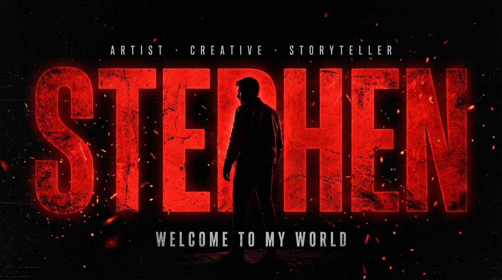
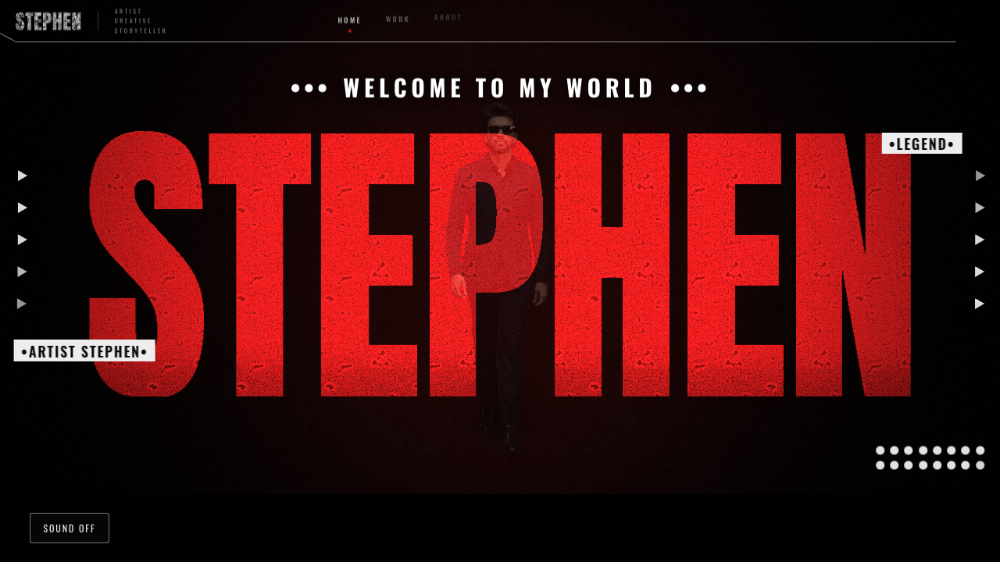

<div align="center">

[](https://stephensh03.github.io/StephensHub03)

# ••• WELCOME TO MY WORLD •••

**`Developer · Designer · Engineer`**

[](https://stephensh03.github.io/StephensHub03)
[](mailto:connect.stephen01@gmail.com)
[](https://www.linkedin.com/in/stephen-profile/)

</div>

---

<div align="center">

> *"Same curiosity. A brighter tomorrow."*

</div>

---

## 🎬 The Portfolio

My portfolio is a **cinematic WebGL experience** — no frameworks, no build step, just raw browser APIs pushed to their limits. Click the banner above or the button to enter.

[](https://stephensh03.github.io/StephensHub03)

> **→ [stephensh03.github.io/StephensHub03](https://stephensh03.github.io/StephensHub03)**

---

## 🌐 What's Inside

| Scene | Description |
|---|---|
| **① Opening** | Black screen → man walks from the dark → STEPHEN wordmark materialises → cinematic composition settles |
| **② Creative Universe** | Film loop played as a section — visitor scrolls in, it arrives from black, a veil breathes over the seam |
| **③ Time Machine** | Cursor swings a real clock hand across 2021–2026 — whichever year it points at lights up |
| **④ Journey** | Measured arc timeline with year cards rising in, the figure standing in front of his own history |
| **⑤ Skills** | Six categories, 33 skills, rendered as a React bundle served from the same static server |
| **⑥ Projects** | Twelve independently animated screens mapped onto a 3D room with perspective CSS |
| **⑦ Certifications** | A wall of 12 certificates inside a warmly lit study |
| **⑧ Finale** | The closing shot — a cinematic still split into breathing parallax layers |

---

## ⚙️ How The Transparent Video Works

The original footage is a person on a white studio backdrop. White is removed **offline** by a custom matte pipeline (border-connected background modelling, fractional hair coverage, motion-adaptive temporal smoothing).

The result is a **double-width video: colour left, alpha matte right** — decoded at runtime by a WebGL compositor into true per-pixel transparency. Works in every browser, including Safari.

---

## 🛠 Tech

<div align="center">


</div>

---

## 📈 GitHub Stats

<div align="center">


</div>

---

## 🏆 Experience

| Year | Role | Company | Stack |
|------|------|---------|-------|
| 2026 | AI Learning Platform | **Black Light Technologies** | AI / Full-Stack / Platform |
| 2025 | AI Question Paper Generator | **Vinayaga Public School** | OCR / LLM / Automation |
| 2025 | AI Object Detection System | **Yaar Solutions** | Computer Vision / AI |
| 2024 | PPE Safety Monitoring | **Ramco Mills** | Vision / Safety AI / Real-Time |

---

## 📜 Certifications

- 🎓 **Full Stack Development** — Error Makes Clever
- 🎓 **Software Engineering** — Accenture · Forage
- 🎓 **Solutions Architecture** — AWS · Forage
- 🎓 **Python** — GUVI
- 🎓 **Prompt Engineering** — Error Makes Clever
- 🎓 **Introduction to Data Science** — Cisco Networking Academy
- 🎓 **Machine Learning with Python** — Infosys Springboard
- 🎓 **Data Analytics Essentials** — Cisco Networking Academy

---

## 🚀 Run Locally

```bash
git clone https://github.com/StephensHub03/StephensHub03.git
cd StephensHub03
python tools/serve.py 5173
# open http://localhost:5173
```

> No npm install needed. No build step. Pure static.

---

<div align="center">

**••• Same curiosity. A brighter tomorrow. •••**

[](https://stephensh03.github.io/StephensHub03)

*Chennai, India*

</div>
