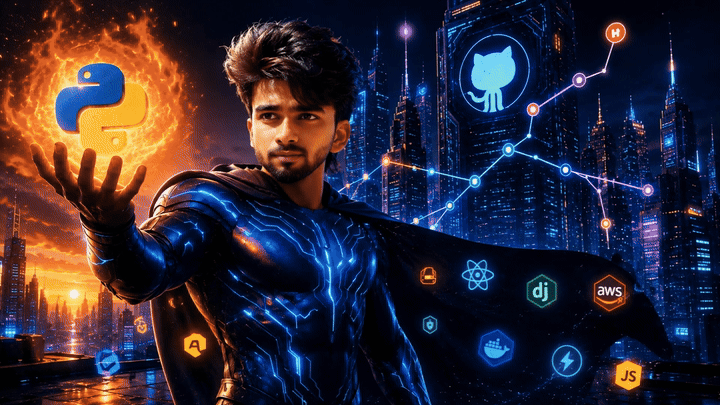
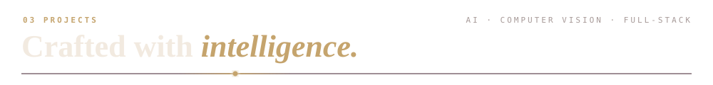
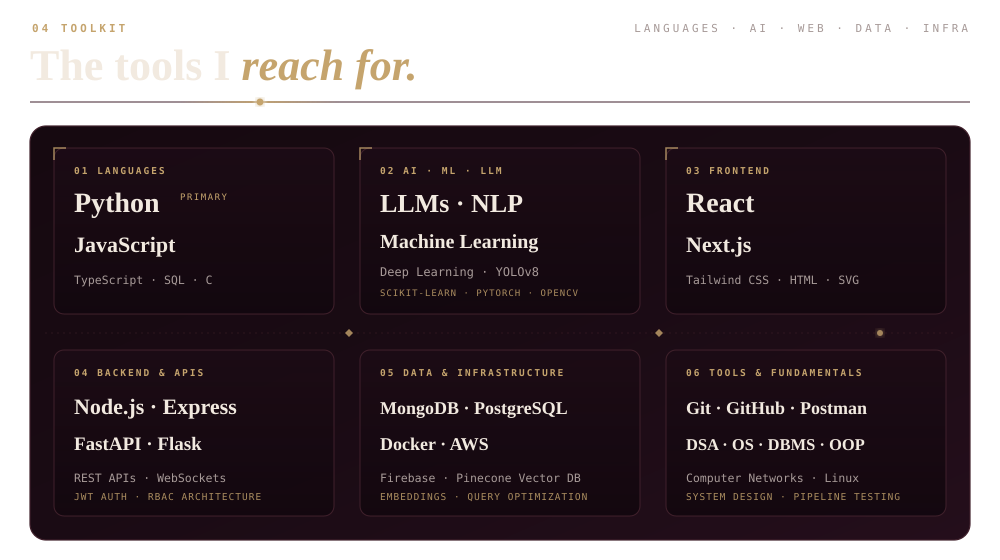
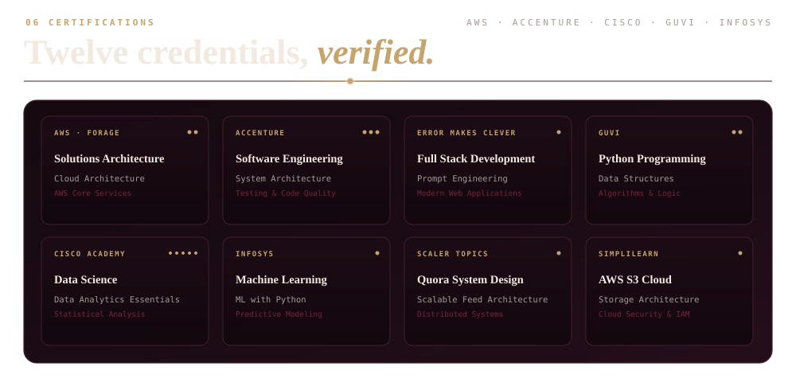
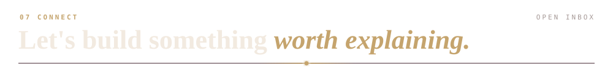

<!-- ═══════════════════════════════════════════════════════════════════
     JEYA STEPHEN — GITHUB PROFILE README
     Dark Cinematic Obsidian · Deep Burgundy · Antique Gold Palette
     ═══════════════════════════════════════════════════════════════════ -->

<!-- ═══ SECTION 01: CINEMATIC HERO ═══ -->

 

<!-- ═══ HERO SOCIAL BADGES STRIP ═══ -->

  
  &nbsp;
  
  &nbsp;
  
  &nbsp;
  
  &nbsp;
  

 

<!-- ═══ SECTION 02: ABOUT ME ═══ -->

  

 

<!-- Editorial Narrative Card with Portrait -->
<table border="0" width="100%" cellspacing="0" cellpadding="0">
  <tr>
    <td width="68%" valign="top">

### Professional Narrative

I am an **AI/ML Engineer and Full-Stack Developer** completing a **B.Tech in Artificial Intelligence and Data Science at Ramco Institute of Technology**. My work spans the continuum from model training and computer vision pipelines to end-to-end full-stack architectures — building resilient systems that perceive, reason, and act.

I focus on production-ready engineering: real-time object detection systems, speech-driven healthcare assistants, LLM-powered SaaS automations, and scalable MERN microservices. I care equally about algorithmic precision, system latency, and crafted user experience.

- **Core Disciplines:** Computer Vision (YOLOv8, OpenCV), LLM Orchestration, NLP Pipelines, Full-Stack Architecture
- **Engineering Values:** Deterministic systems, verifiable AI outputs, and clean, modular interfaces
- **Education:** B.Tech AI & Data Science · Ramco Institute of Technology
- **Current Location:** Chennai, India · Open to high-impact engineering opportunities

  </td>
  <td width="32%" valign="middle" align="center">
    
     
    <code style="color: #C5A46D;">JEYA STEPHEN · CHENNAI, INDIA</code>
  </td>
</tr>
</table>

 

---

 

<!-- ═══ SECTION 03: ENGINEERING IN MOTION / VIDEO REEL ═══ -->

  <table border="0" width="100%" cellspacing="0" cellpadding="0">
    <tr>
      <td align="center" style="background-color: #160910; border: 1.5px solid #40202B; border-radius: 14px; padding: 18px;">
        

          
        

        

          <b style="color: #C5A46D;">ENGINEERING IN MOTION</b> · Real-time vision systems, intelligent workflows, and interactive web applications · <a href="public/github.mp4"><b>Watch Full 1080p HD Reel (MP4) ↗</b></a>
        

      </td>
    </tr>
  </table>

 

<!-- ═══ SECTION 04: SELECTED PROJECTS ═══ -->

  

 

<table border="0" width="100%">
<tr>
<td width="50%" valign="top">

### 🛡️ SentinelVision AI
> **Real-Time Computer Vision &amp; Site Safety**

Autonomous safety surveillance system detecting personal protective equipment (PPE), hardhats, and safety vests in high-risk environments. Generates sub-second incident alerts and visual evidence logs.

- **Stack:** `Python` `YOLOv8` `OpenCV` `FastAPI` `React`
- **Focus:** Real-time object detection, automated compliance, edge inference
- **Showcase:** [View in Portfolio ↗](https://stephen-s-portfolio-psi.vercel.app/#projects)

</td>
<td width="50%" valign="top">

### ⚡ Postly
> **Autonomous AI Social Media Automation**

Intelligent content pipeline leveraging LLMs to draft, schedule, and publish cross-platform content with tone alignment, engagement analytics, and automated workflow triggers.

- **Stack:** `Next.js` `Node.js` `OpenAI API` `MongoDB` `Tailwind`
- **Focus:** LLM agent workflows, multi-channel scheduling, SaaS architecture
- **Showcase:** [View in Portfolio ↗](https://stephen-s-portfolio-psi.vercel.app/#projects)

</td>
</tr>
<tr>
<td width="50%" valign="top">

### 🎯 HireSense AI
> **Intelligent Resume Screening &amp; Candidate Ranking**

Semantic parser and candidate ranking engine evaluating structured resumes against competency matrices using dense vector embeddings and NLP relevance scoring models.

- **Stack:** `Python` `FastAPI` `spaCy` `React` `MongoDB`
- **Focus:** Information extraction, semantic scoring, talent analytics
- **Showcase:** [View in Portfolio ↗](https://stephen-s-portfolio-psi.vercel.app/#projects)

</td>
<td width="50%" valign="top">

### 🩺 VoxCare
> **Voice-First Intelligent Healthcare Assistant**

Interactive clinical assistant allowing patients to communicate symptoms through conversational speech, retrieving structured guidance and clinical records with low latency.

- **Stack:** `Python` `Speech-to-Text` `LLM` `FastAPI` `React`
- **Focus:** Natural speech processing, real-time voice synthesis, conversational AI
- **Showcase:** [View in Portfolio ↗](https://stephen-s-portfolio-psi.vercel.app/#projects)

</td>
</tr>
<tr>
<td width="50%" valign="top">

### 📊 TweetSense
> **Large-Scale Sentiment Analysis Pipeline**

Social stream sentiment classification engine deployed as a containerized REST API, processing high-volume text streams into actionable categorical signals.

- **Stack:** `Python` `Scikit-learn` `NLTK` `Flask` `Pandas`
- **Focus:** Text classification, model serialization, API latency optimization
- **Showcase:** [View in Portfolio ↗](https://stephen-s-portfolio-psi.vercel.app/#projects)

</td>
<td width="50%" valign="top">

### 🎓 InternX
> **Academic &amp; Internship Management Platform**

Comprehensive internship and learning coordination portal with automated session scheduling, assignment delivery, progress dashboards, and mentor-student collaboration channels.

- **Stack:** `React` `Node.js` `Express` `MongoDB` `REST APIs`
- **Focus:** Role-based access control (RBAC), calendar integration, workflow tracking
- **Showcase:** [View in Portfolio ↗](https://stephen-s-portfolio-psi.vercel.app/#projects)

</td>
</tr>
</table>

 

---

 

<!-- ═══ SECTION 05: TOOLKIT ═══ -->

  

 

<b style="color: #C5A46D;">Explore Detailed Technology Inventory (Expand Table)</b>

 

| Category | Primary Technologies &amp; Tools | Engineering Context |
|---|---|---|
| **01 Languages** | Python *(Primary)*, JavaScript, TypeScript, SQL, C | Algorithmic logic, scripting, typed web apps, data querying |
| **02 AI · ML · LLM** | PyTorch, TensorFlow, YOLOv8, OpenCV, Transformers, spaCy, Scikit-learn | Computer vision, object detection, embeddings, text parsing |
| **03 Frontend** | React, Next.js, Tailwind CSS, HTML5, CSS3, SVG, HTML Canvas | Editorial design systems, responsive interfaces, micro-interactions |
| **04 Backend &amp; APIs** | Node.js, Express, FastAPI, Flask, REST APIs, WebSockets, JWT Auth | Asynchronous servers, microservice APIs, authentication, real-time sockets |
| **05 Data &amp; Infra** | MongoDB, PostgreSQL, Pinecone Vector DB, Firebase, Docker, AWS, Vercel | Relational & NoSQL schemas, vector search, containerization, cloud hosting |
| **06 Fundamentals** | Git, GitHub, Postman, Linux, DSA, OOP, DBMS, System Architecture | Version control, CI/CD, modular architecture, distributed system design |

 

---

 

<!-- ═══ SECTION 06: COMMIT LOG & GITHUB ACTIVITY ═══ -->

  

 

  
  &nbsp;
  

  

<!-- GitHub Contribution Snake Animation -->

  

<i>Live telemetry updated continuously via the GitHub API for <a href="https://github.com/StephensHub03">@StephensHub03</a>.</i>

 

---

 

<!-- ═══ SECTION 07: CERTIFICATIONS & ACHIEVEMENTS ═══ -->

  

 

<b style="color: #C5A46D;">View Verified Credential List &amp; Issuing Bodies</b>

 

| Issuing Body | Credential Title | Domain Focus |
|---|---|---|
| **AWS · Forage** | Solutions Architecture | Cloud infrastructure, scalability &amp; core AWS services |
| **Accenture · Forage** | Software Engineering | Enterprise architecture, unit testing &amp; code quality |
| **Error Makes Clever** | Full Stack Development | Production MERN stack, database design &amp; deployment |
| **Error Makes Clever** | Prompt Engineering | LLM steering, context orchestration &amp; inference design |
| **GUVI** | Python Programming | Data structures, algorithms &amp; computational problem solving |
| **Cisco Networking Academy** | Introduction to Data Science | Data wrangling, exploratory data analysis &amp; visualization |
| **Cisco Networking Academy** | Data Analytics Essentials | Statistical modeling, analytical reporting &amp; business metrics |
| **Infosys Springboard** | Machine Learning with Python | Supervised &amp; unsupervised ML, regression &amp; classification |
| **Scaler Topics** | Quora System Design | High-traffic distributed architectures, caching &amp; feed pipelines |
| **Simplilearn SkillUp** | AWS S3 for Beginners | Cloud object storage, lifecycle policies, security &amp; IAM |
| **Great Learning** | Python Data Structures | Dynamic programming, recursion &amp; algorithmic efficiency |
| **InternPE** | Python Programming Internship | Applied project engineering, code reviews &amp; delivery |

 

---

 

<!-- ═══ SECTION 08: CONNECT ═══ -->

  

 

<table border="0" width="100%" cellspacing="0" cellpadding="0">
  <tr>
    <td width="35%" valign="middle" align="center">
      
       
      <code style="color: #C5A46D;">JEYA STEPHEN · CHENNAI, INDIA</code>
    </td>
    <td width="65%" valign="middle">

### Let's Collaborate

I am continuously exploring collaborations in **AI/ML systems, computer vision engineering, and full-stack software development**. Whether you have an ambitious platform to build, a research prototype to productionize, or an engineering role to discuss, feel free to reach out.

  

  

  

  

  

  </td>
</tr>
</table>

 

<!-- ═══ SECTION 09: SIGNATURE FOOTER ═══ -->

  

