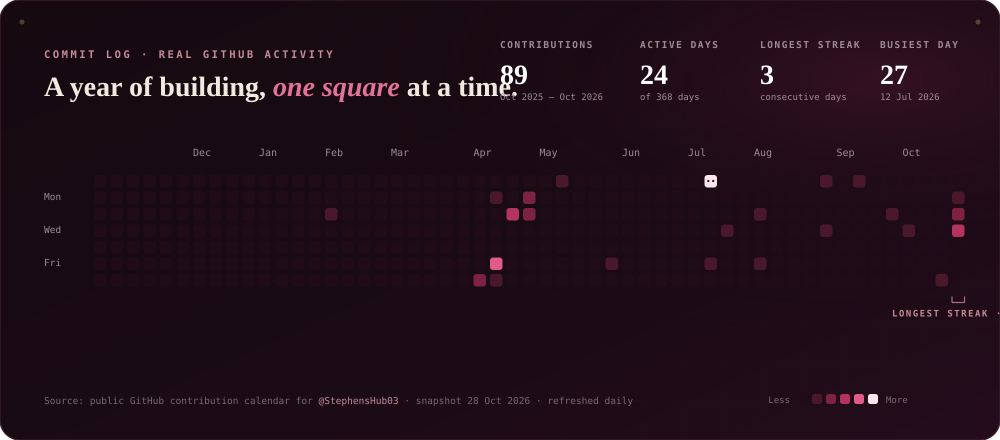
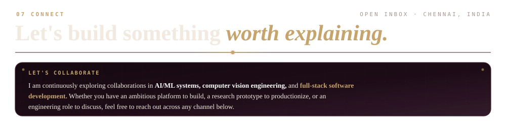
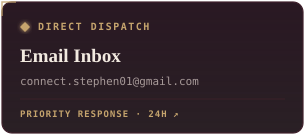
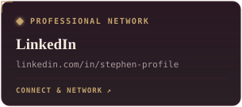

<!-- ═══════════════════════════════════════════════════════════════════
     JEYA STEPHEN — GITHUB PROFILE README
     Dark Cinematic Obsidian · Deep Burgundy · Antique Gold Palette
     ═══════════════════════════════════════════════════════════════════ -->

<!-- ═══ SECTION 01: CINEMATIC HERO ═══ -->

 

<!-- ═══ HERO SOCIAL BADGES STRIP ═══ -->

  
  &nbsp;
  
  &nbsp;
  
  &nbsp;
  
  &nbsp;
  

 

<!-- ═══ SECTION 02: ABOUT ME ═══ -->

  

 

<!-- ═══ SECTION 02: PROFESSIONAL NARRATIVE ═══ -->

  

 

<!-- ═══ SECTION 03: ENGINEERING IN MOTION / VIDEO REEL ═══ -->

  <table border="0" width="100%" cellspacing="0" cellpadding="0">
    <tr>
      <td align="center" style="background-color: #160910; border: 1.5px solid #40202B; border-radius: 14px; padding: 18px;">
        

          
        

      </td>
    </tr>
  </table>

 

<!-- ═══ SECTION 03: SELECTED PROJECTS ═══ -->

  

 

<!-- ═══ SECTION 05: TOOLKIT ═══ -->

  

 

<b style="color: #C5A46D;">Explore Detailed Technology Inventory (Expand Table)</b>

 

| Category | Primary Technologies &amp; Tools | Engineering Context |
|---|---|---|
| **01 Languages** | Python *(Primary)*, JavaScript, TypeScript, SQL, C | Algorithmic logic, scripting, typed web apps, data querying |
| **02 AI · ML · LLM** | PyTorch, TensorFlow, YOLOv8, OpenCV, Transformers, spaCy, Scikit-learn | Computer vision, object detection, embeddings, text parsing |
| **03 Frontend** | React, Next.js, Tailwind CSS, HTML5, CSS3, SVG, HTML Canvas | Editorial design systems, responsive interfaces, micro-interactions |
| **04 Backend &amp; APIs** | Node.js, Express, FastAPI, Flask, REST APIs, WebSockets, JWT Auth | Asynchronous servers, microservice APIs, authentication, real-time sockets |
| **05 Data &amp; Infra** | MongoDB, PostgreSQL, Pinecone Vector DB, Firebase, Docker, AWS, Vercel | Relational & NoSQL schemas, vector search, containerization, cloud hosting |
| **06 Fundamentals** | Git, GitHub, Postman, Linux, DSA, OOP, DBMS, System Architecture | Version control, CI/CD, modular architecture, distributed system design |

 

<!-- ═══ SECTION 06: COMMIT LOG & GITHUB ACTIVITY ═══ -->

  

 

  

 

  
  &nbsp;
  

 

<!-- ═══ SECTION 07: CERTIFICATIONS & ACHIEVEMENTS ═══ -->

  

 

<b style="color: #C5A46D;">View Verified Credential List &amp; Issuing Bodies</b>

 

| Issuing Body | Credential Title | Domain Focus |
|---|---|---|
| **AWS · Forage** | Solutions Architecture | Cloud infrastructure, scalability &amp; core AWS services |
| **Accenture · Forage** | Software Engineering | Enterprise architecture, unit testing &amp; code quality |
| **Error Makes Clever** | Full Stack Development | Production MERN stack, database design &amp; deployment |
| **Error Makes Clever** | Prompt Engineering | LLM steering, context orchestration &amp; inference design |
| **GUVI** | Python Programming | Data structures, algorithms &amp; computational problem solving |
| **Cisco Networking Academy** | Introduction to Data Science | Data wrangling, exploratory data analysis &amp; visualization |
| **Cisco Networking Academy** | Data Analytics Essentials | Statistical modeling, analytical reporting &amp; business metrics |
| **Infosys Springboard** | Machine Learning with Python | Supervised &amp; unsupervised ML, regression &amp; classification |
| **Scaler Topics** | Quora System Design | High-traffic distributed architectures, caching &amp; feed pipelines |
| **Simplilearn SkillUp** | AWS S3 for Beginners | Cloud object storage, lifecycle policies, security &amp; IAM |
| **Great Learning** | Python Data Structures | Dynamic programming, recursion &amp; algorithmic efficiency |
| **InternPE** | Python Programming Internship | Applied project engineering, code reviews &amp; delivery |

 

<!-- ═══ SECTION 07: CONNECT ═══ -->

  

  
  &nbsp;
  
  &nbsp;
  

  

 

  
  &nbsp;
  
  &nbsp;
  
  &nbsp;
  

 

<!-- ═══ SECTION 09: SIGNATURE FOOTER ═══ -->

  

